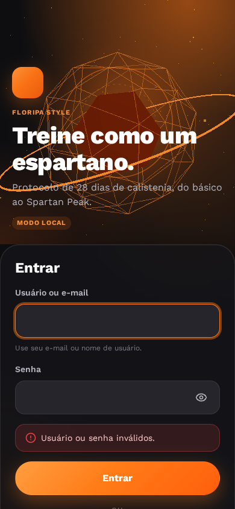
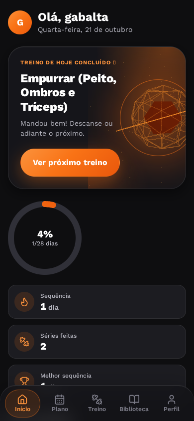
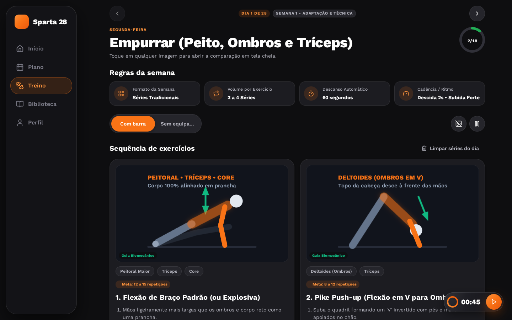

# Calistenia Training • Sparta 28

App web de treino de calistenia com login, progresso salvo e planos. Ele começa com o **Protocolo 28 Dias de Calistenia Espartana** e já está preparado para receber outros planos. O visual segue os padrões do [Sandow UI Kit: AI Fitness & Nutrition App (Figma Community)](https://www.figma.com/design/F6K1efFB6H5Pl0VmEA1hEH/sandow-UI-Kit--AI-Fitness---Nutrition-App--Community-): tema escuro, laranja de destaque, cartões glass e um fundo 3D leve.

Site: <https://gabriel-baltazar.github.io/calistenia-training/>

### Capturas de tela

As capturas entram depois da verificação visual no navegador. Por enquanto não há imagens versionadas, então esta seção fica sem links para não mostrar imagens quebradas.

<!-- Links pendentes (adicionar quando os arquivos existirem em docs/screenshots/):



-->

## Funcionalidades

- **Planos de treino**: tela Planos para escolher, começar, retomar ou trocar de plano. Os próximos planos aparecem como "Em breve".
- **Protocolo 28 Dias**: 4 fases (Semana 1 a 4) com séries, descanso e cadência próprios de cada fase.
- **Treino do dia**: exercícios com séries marcáveis, meta, passo a passo, anatomia e mídia, seletor de equipamento (Com barra / Sem equipamento) e cronômetro de descanso automático (contagem regressiva e cronômetro livre).
- **Biblioteca** de exercícios com busca sem acento e filtros.
- **Progresso**: anel de progresso, sequência de dias, calendário do plano e histórico.
- **Exportar/importar** o progresso em JSON.
- **Migração automática** do app antigo (os dados do navegador são importados no primeiro acesso, sem apagar os originais).
- **Login** por e-mail ou usuário e senha, com Google (modo Firebase) ou no modo local.
- **"Adicionar à tela inicial"** via manifest. É best-effort: só há ícone SVG, então o prompt automático do Android pode não aparecer.
- **Efeitos**: fundo 3D (three.js), cartões glass e animações que respeitam "reduzir movimento".

## Stack

Vite 5, React 18, TypeScript, React Three Fiber / three.js, Framer Motion, Firebase Auth, IndexedDB (idb), React Router (HashRouter) e CSS Modules. Fonte Work Sans auto-hospedada.

## Rodando localmente

Requer Node 20 ou mais novo.

```bash
npm install
cp .env.example .env.local   # opcional: sem Firebase o app roda em modo local
npm run dev                  # http://localhost:5173/calistenia-training/
```

Outros comandos:

```bash
npm run build      # typecheck + build de produção em dist/
npm run preview    # serve o dist/ em http://localhost:4173/calistenia-training/
npm run lint
npm run typecheck
```

## Modo local

> ⚠️ **O modo local não é segurança real.**
>
> - Ele fica ativo quando faltam as variáveis do Firebase.
> - Só o usuário `gabalta` entra.
> - A senha é conferida por um hash SHA-256 embutido no código, **sem sal**. Qualquer pessoa com o bundle pode tentar descobri-la offline.
> - Os dados ficam só neste navegador.
> - Exige HTTPS ou `localhost` (o hash usa a Web Crypto API).

Para trocar a senha local, gere o novo hash e substitua o valor de `OWNER_PASSWORD_SHA256` em `src/auth/ownerHash.ts`:

```bash
printf '%s' 'NOVA_SENHA' | sha256sum
```

## Configurando o Firebase (passo a passo)

1. No [console do Firebase](https://console.firebase.google.com/), crie um projeto.
2. Adicione um app **Web** e copie a configuração (`apiKey`, `authDomain`, `projectId`, `appId`, `storageBucket`, `messagingSenderId`).
3. Em **Authentication › Sign-in method**, habilite **E-mail/senha** e **Google** (defina o e-mail de suporte do projeto).
4. Em **Authentication › Settings › Authorized domains**, adicione `gabriel-baltazar.github.io` (o `localhost` já vem na lista).
5. Em **Authentication › Users › Add user**, crie o usuário dono com o seu e-mail e a sua senha. Essa senha fica só no Firebase e nunca vai para o repositório.
6. Defina `VITE_OWNER_EMAIL` com esse e-mail. Com ele, o login com o usuário `gabalta` usa esse e-mail.
7. Para desenvolver, preencha o `.env.local` (a partir do `.env.example`) com a configuração e o `VITE_OWNER_EMAIL`.

> ⚠️ **Google e a senha do dono.** O Firebase usa uma conta por e-mail. Se você entrar com Google usando o **mesmo Gmail** do usuário criado no console (passo 5), o Firebase troca a credencial de senha pela do Google: o uid e o progresso continuam, mas o login com `gabalta` + senha deixa de funcionar.
>
> - **Como recuperar:** Authentication › Users › ⋮ (no usuário) › **Redefinir senha** e defina a senha de novo pelo e-mail recebido.
> - **Como evitar:** use só um método de login para o e-mail do dono, ou use em `VITE_OWNER_EMAIL` um e-mail que não seja Gmail (diferente da sua conta Google).

## Deploy no GitHub Pages

O workflow `.github/workflows/deploy.yml` faz lint, build e publica o `dist/` a cada push em `master` (ou manualmente). Siga esta ordem:

1. **Antes do primeiro merge desta versão:** Settings › Pages › Build and deployment › Source = **GitHub Actions**. Sem isso o site fica quebrado: o Pages passaria a servir o `index.html` de desenvolvimento e o deploy do workflow falha.
2. Settings › Secrets and variables › Actions: crie `VITE_FIREBASE_API_KEY`, `VITE_FIREBASE_AUTH_DOMAIN`, `VITE_FIREBASE_PROJECT_ID`, `VITE_FIREBASE_APP_ID` (mais os opcionais `VITE_FIREBASE_STORAGE_BUCKET` e `VITE_FIREBASE_MESSAGING_SENDER_ID`) e `VITE_OWNER_EMAIL`. Pode ser secret ou variable: a config web do Firebase não é sigilosa, mas o workflow aceita os dois. Sem eles o site sai em modo local.
3. Faça push/merge em `master`, ou rode Actions › "Deploy no GitHub Pages" › **Run workflow** (necessário se os secrets forem criados depois do merge).

**Limitação do Google no celular:** o login usa popup. Se o navegador bloquear, o app tenta redirect, que pode falhar em navegadores que bloqueiam cookies de terceiros. Nesse caso, permita popups para o site.

## Dados e privacidade

- O progresso fica no **IndexedDB** do navegador, separado por usuário.
- Em Perfil dá para **exportar** (arquivo `calistenia-progresso-AAAA-MM-DD.json`) e **importar** o progresso.
- **Migração do app antigo:** os dados de `spartan28_state_v2` (localStorage) são importados no primeiro acesso. A migração não é destrutiva: a chave antiga continua lá.
- Sincronizar entre aparelhos (Firestore) é um passo futuro: basta outra implementação de `ProgressRepository`.

## Como adicionar um novo plano

Crie `src/plans/<id>/index.ts` com `export default` de um `TrainingPlan`. O registry descobre a pasta sozinho (`import.meta.glob`), sem editar mais nada. Exemplo mínimo com 1 fase e 2 dias:

```ts
import type { Exercise, TrainingPlan } from '../types';

const prancha: Exercise = {
  id: 'plank_hold',
  name: 'Prancha',
  mediaId: 'Plank',
  category: 'core',
  muscleGroup: 'Abdômen • Core',
  muscleGroups: ['Abdômen', 'Core'],
  target: '30 segundos',
  sets: 3,
  restSeconds: 45,
  instructions: ['Apoie antebraços e pontas dos pés.', 'Mantenha o corpo alinhado.'],
  anatomy: 'core',
  timer: { kind: 'countdown', seconds: 30 },
};

const plan: TrainingPlan = {
  id: 'core-2',
  name: 'Core em 2 Dias',
  tagline: 'Exemplo mínimo',
  description: 'Plano de exemplo com uma fase.',
  durationDays: 2,
  level: 'iniciante',
  levelLabel: 'Iniciante',
  equipmentLabel: 'Sem equipamento',
  coverEmoji: '🔥',
  order: 10,
  phases: [
    {
      id: 'fase-1',
      name: 'Base',
      shortName: 'Fase 1',
      rulesTitle: 'Fase 1: Base',
      dayRange: [1, 2],
      description: 'Aprenda a posição.',
      format: '3 séries',
      setsLabel: '3 séries',
      restLabel: '45 s',
      tempo: 'Controlado',
    },
  ],
  days: [1, 2].map((day) => ({
    day,
    phaseId: 'fase-1',
    weekdayLabel: day === 1 ? 'Segunda-feira' : 'Terça-feira',
    weekdayShort: day === 1 ? 'Seg' : 'Ter',
    title: `Core ${day}`,
    subtitle: 'Prancha com respiração controlada.',
    kind: 'training',
    exercises: [prancha],
  })),
};

export default plan;
```

Regras:

- `order` (opcional) define a posição na tela Planos (menor primeiro).
- Id do plano em `[a-z0-9-]+`.
- Ids de exercício em **`[a-z0-9_]+`** (minúsculas, dígitos e `_`; hífen não é aceito), únicos no dia e estáveis: eles fazem parte da chave do progresso salvo.
- A mídia é opcional e usa os ids do [free-exercise-db](https://github.com/yuhonas/free-exercise-db).
- Se o plano estava como "Em breve", remova o placeholder de `src/plans/upcoming.ts`.
- Em dev, o validador do registry mostra os erros no console.

## Estrutura do projeto

```
.github/workflows/deploy.yml   deploy no GitHub Pages
docs/legacy/                   app antigo (HTML único), mantido como referência
public/                        favicon e manifest
src/
  auth/        login local e Firebase, sessão, rota protegida
  components/  ui, layout, exercise, plan, timer, three (fundo 3D)
  config/      leitura das variáveis VITE_*
  design/      tokens, CSS global (glass), animações
  hooks/  lib/ utilitários
  plans/       registry, tipos, validador e calistenia-28/
  progress/    provider, seletores, import/export
  screens/     Login, Início, Plano, Treino, Biblioteca, Planos, Perfil
  storage/     IndexedDB e migração do app antigo
  timer/       cronômetro e sons
```

## Créditos

- Imagens dos exercícios: [free-exercise-db](https://github.com/yuhonas/free-exercise-db) (Unlicense).
- Inspiração visual: Sandow UI Kit (Figma Community).
- Fonte: Work Sans (SIL Open Font License).

## Nota sobre o protocolo

- O HIIT de quinta usa **20 s de descanso**, como diz o texto do protocolo. Por isso o cartão "Descanso Automático" mostra "20 segundos" nesses dias.
- Os subtítulos de quarta e sábado foram adaptados ao novo layout (sem "lateral esquerda" e "rodapé").
